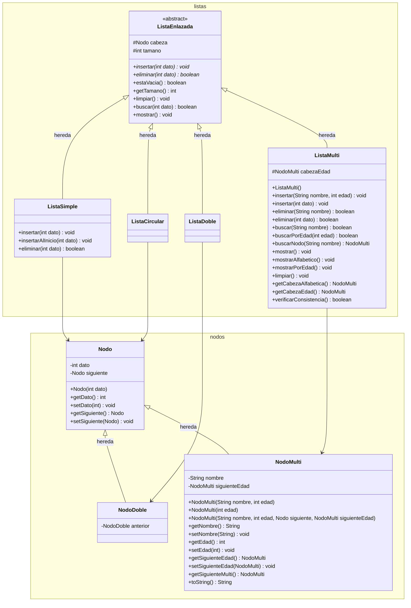

# Diagrama de Clases - Listas Enlazadas

Diagrama de clases UML del módulo `src` para las listas enlazadas y sus respectivos nodos, incorporando la modelación de personas (Nombre + Edad) en la Multilista.

