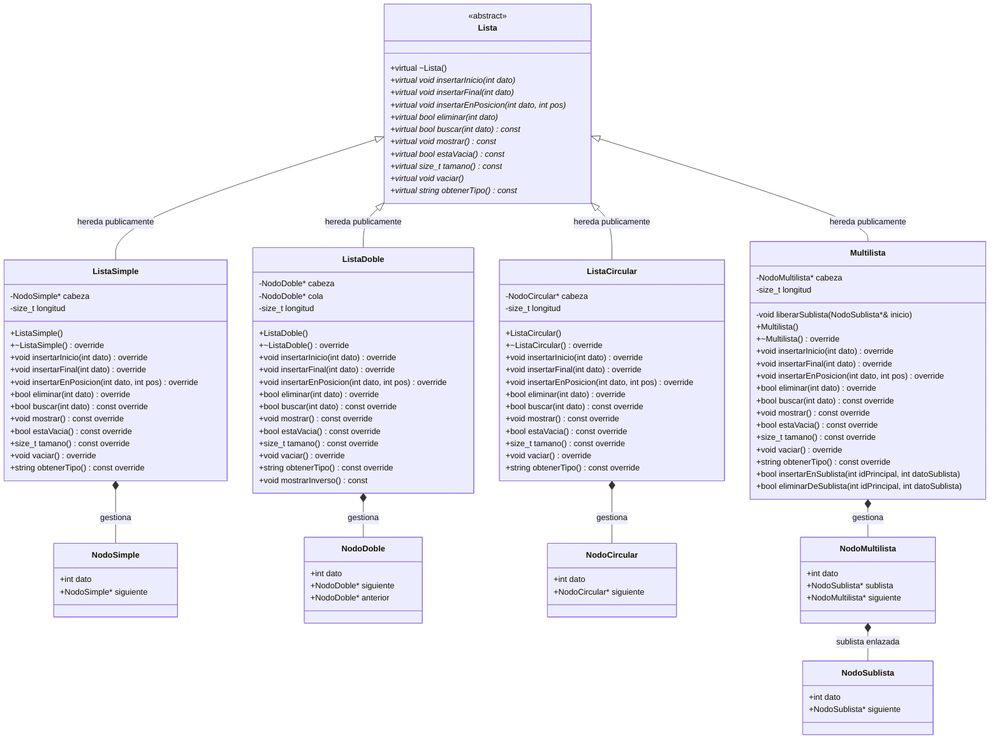
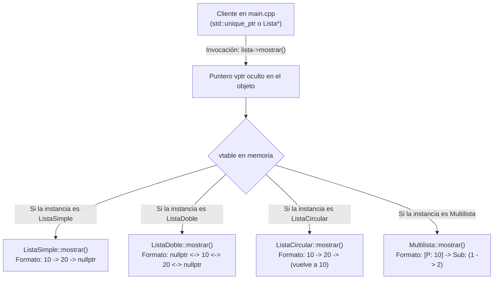
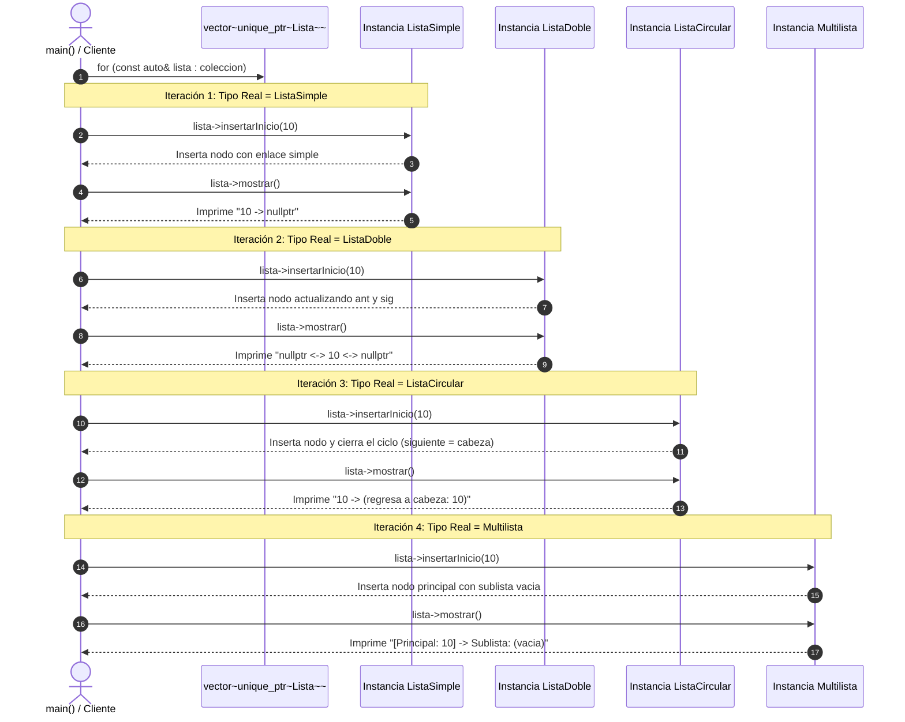

# Diagrama y Desglose de Herencia y Polimorfismo

Este documento desglosa la **arquitectura orientada a objetos**, el **árbol de herencia**, la **relación con los nodos**, el **comportamiento polimórfico en tiempo de ejecución (vtable / dynamic dispatch)** y las particularidades de cada tipo de lista del proyecto.

> **Tip para VS Code:** Para visualizar este archivo con todos sus diagramas renderizados en VS Code, presiona `Ctrl + Shift + V` (o `Ctrl + K` seguido de `V` para abrir la vista previa al lado).

---

## 1. Diagrama de Clases UML (Herencia y Composición)



---

## 2. Flujo de Polimorfismo en Tiempo de Ejecución (Despacho Dinámico / vtable)

Cuando el cliente interactúa con las listas en [`main.cpp`](main.cpp), no necesita saber qué tipo de lista concreta está manejando. El despachador dinámico utiliza la **tabla virtual (`vtable`)**:



---

## 3. Secuencia de Ejecución Polimórfica (Bucle Unificado)

En la función `ejecutarDemostracionPolimorfismo()` de `main.cpp`, un solo bloque de código itera sobre todas las clases derivadas de manera uniforme:



---

## 4. Matriz Comparativa del Comportamiento de Cada Clase Derivada

| Método de la Interfaz Base | `ListaSimple` | `ListaDoble` | `ListaCircular` | `Multilista` |
| :--- | :--- | :--- | :--- | :--- |
| **`insertarInicio(dato)`** | Crea `NodoSimple`, actualiza `cabeza`. | Crea `NodoDoble`, actualiza `cabeza` y el puntero `anterior` del nodo previo. | Crea `NodoCircular`, busca el último nodo para que apunte al nuevo y actualiza `cabeza`. | Crea `NodoMultilista` (nodo principal) con `sublista = nullptr` al inicio. |
| **`insertarFinal(dato)`** | Recorre con `siguiente` hasta el último nodo y enlaza. | Enlaza directo al final en $O(1)$ gracias al puntero `cola`. | Busca el último nodo (el que apunta a `cabeza`), lo enlaza al nuevo y el nuevo apunta a `cabeza`. | Recorre la lista principal de nodos y enlaza el nuevo nodo principal al final. |
| **`eliminar(dato)`** | Ajusta el puntero `siguiente` del nodo anterior y libera el nodo actual. | Ajusta tanto `siguiente` del anterior como `anterior` del siguiente. Gestiona `cola`. | Si se elimina la cabeza, actualiza el enlace del último nodo. Si es único, `cabeza = nullptr`. | Localiza el nodo principal, **libera toda su sublista primero** y luego elimina el nodo principal. |
| **`buscar(dato)`** | Recorrido lineal simple hasta `nullptr`. | Recorrido lineal simple desde `cabeza` a `nullptr`. | Recorrido con bucle `do-while` hasta volver a `cabeza`. | Busca si el valor coincide con el ID principal o con algún elemento dentro de las sublistas. |
| **`mostrar()`** | `10 -> 20 -> nullptr` | `nullptr <-> 10 <-> 20 <-> nullptr` | `10 -> 20 -> (regresa a cabeza: 10)` | Jerárquico: `[Principal: X] -> Sublista: (Y -> Z)` |
| **`vaciar()` / Destructor** | Itera liberando nodos hasta `nullptr`. | Itera liberando nodos hasta `nullptr`. Resetea `cola`. | **Rompe el ciclo** (`ultimo->siguiente = nullptr`) para evitar bucle infinito y libera linealmente. | Itera cada nodo principal liberando completamente su sublista asociada y luego el nodo. |
| **Métodos Propios (Extensión)** | Ninguno (cumple interfaz base). | `mostrarInverso()` (recorre desde `cola` hacia `cabeza`). | Ninguno (cumple interfaz base). | `insertarEnSublista(id, val)`, `eliminarDeSublista(id, val)`. |

---

## 5. El Papel del Destructor Virtual y Downcasting

### A. Destructor Virtual (`virtual ~Lista() = default;`)
Garantiza que cuando se destruye un puntero de tipo `std::unique_ptr<Lista>` o `Lista*`, el compilador busque en la tabla virtual el destructor específico de la subclase:
1. Si el objeto es `Multilista`, se invoca `Multilista::~Multilista()`, que llama a `vaciar()`, liberando sublistas y nodos principales.
2. Si `~Lista()` no fuese virtual, se llamaría únicamente al destructor vacío de `Lista`, provocando fugas de memoria críticas de todos los nodos.

### B. Downcasting Seguro (`dynamic_cast`)
En el menú interactivo, la función `menuOperaciones(Lista* lista)` recibe un puntero general `Lista*`. Cuando se requiere invocar un método que no pertenece a la interfaz general (como `mostrarInverso()` o `insertarEnSublista()`):
```cpp
ListaDoble* listaDoble = dynamic_cast<ListaDoble*>(lista);
if (listaDoble != nullptr) {
    // Es seguro invocar métodos exclusivos de ListaDoble
    listaDoble->mostrarInverso();
}
```
Si el objeto no es del tipo consultado, `dynamic_cast` retorna `nullptr`, garantizando total seguridad en tiempo de ejecución.
